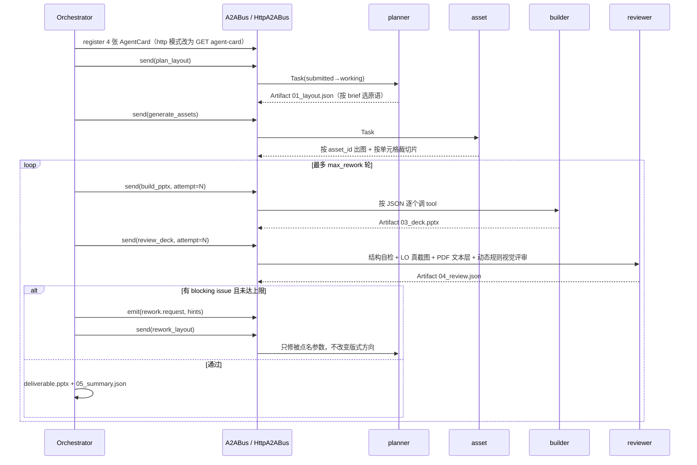

# A2A 编排：通用广告级「原生可编辑 PPTX」生成流水线

代码：`F:\python_program\a2appt` ｜ 环境：`F:\python_env\a2a_env`（Python 3.12 venv）

按「路线 B 全自动 Agent 链路」落地：**4 个 A2A Agent 各司其职，通过 Task/Artifact 交接，评审不合格自动回退返修**，最终交付所有文字都可双击修改的 `.pptx`。

> **版式是数据，不是代码。** 流水线不预设任何构图。柱状连续全景只是 `mask_picture` 的一种参数组合
> (`layout=columns, continuous=true`)，和纯文字极简、全幅背景图、圆形裁图、多图网格、斜切分栏一样，
> 都只是「版式 JSON 的一种取值」。Planner 按 brief 选原语，Builder 只按 JSON 执行。

支持两种 transport：`inproc`（进程内总线，默认）和 `http`（**真实 HTTP A2A**：AgentCard 发现 + JSON-RPC `message/send` 委派）。

---

## 0. 核验结果（与参考工作流的出入，全部实测过）

| # | 参考说法 | 实测结论 | 本项目处理 |
|---|---|---|---|
| 1 | 语言模型 `gpt6.2Astra`、生图 `gpt2.6img` | 端点 `/v1/models` 共 33 个模型，真实 ID 是 `gpt-6.2-astra`；生图是 `gpt-image-2.6-flare` / `-sunburst`。别名直连 404 | `config.py` 别名解析；`run.py --check-models` 复核 |
| 2 | 「底层接口 `shape.fill.picture`」 | **不存在**。python-pptx 1.0.2 的 `FillFormat` 只有 solid/gradient/pattern/background；`pptx-mcp-server` 0.5.1 也只有 `add_picture` | 手写 OOXML `a:blipFill` + `r:embed` 图片关系，封装在 `ppt/builder.py::_picture_fill()` |
| 3 | 本机没有渲染器，无法逐页截图 | **第一版判断错了**：`C:\Program Files\LibreOffice\program\soffice.exe` 完整可用，只是不在 PATH 里 | `ppt/render.py` 加固定安装路径探测；每次自检产出**真实截图** `04_screenshots/slide_N_real.png` |
| 4 | 用 `a:srcRect` 给形状裁图即可 | **LibreOffice 会忽略 `a:srcRect`**，导致每个形状都把整张图压缩显示 | 改为**预裁切片**：素材阶段按格子几何裁成独立 PNG（`ppt/slicing.py`），跨渲染器一致 |
| 5 | HTTP 委派 60s 够了 | 多图网格一次 `message/send` 串 4 次生图，实测撑爆 60s | `A2A_HTTP_TIMEOUT=600`，按最慢 Task 给超时 |
| 6 | 复用运行目录重跑没问题 | LibreOffice 不覆盖同名 PDF；删掉 PDF 又会因复用 `_lo_profile` 残留锁而 `exit=1`，导致**截图是上一轮的旧图** | `render.py` 每次转换用独立临时目录（独立 profile + 独立输出）再拷回 PDF，并清理历史残留 |
| 7 | 本机没有 PowerPoint / WPS | **又漏了一处**：WPS 12.1.0.29681 装在 `F:\ｓｏｆｔ\wps\WPS Office`（全角目录 + 自定义盘符），不在任何标准路径。的 `ppt2pdf` 可让自检截图走 WPS 渲染，但**需要登录 WPS 账号且有转换权限**（未登录 `exit 100`）；COM ProgID `KWPP.Application` / `PowerPoint.Application` 已注册 | `render.py` 补 WPS 路径探测与可选渲染分支（`A2A_RENDERER=wps`，默认关闭）；转换失败自动回退 LibreOffice。该分支只影响截图，不影响 PPTX 交付 |

`compono 0.5.1` / `compono-mcp 0.1.4` 在 PyPI 确实存在（已核验），未引入，理由见第 7 节。

---

## 1. 版式原语（核心设计）

**只有 7 种原语，任意组合都是合法版式：**

| 原语 | 产出 | 什么时候用 |
|---|---|---|
| `text` | 原生文本框 | 所有文字，永远如此 |
| `shape` | 原生形状（含三角/平行四边形/六边形等） | 色块、斜切、遮罩、分隔线 |
| `picture` | 独立图片图层 | 可单独删换的图片 |
| `mask_picture` | 形状内图片填充 | **仅当 brief 要求裁切/拼接效果** |
| `decorate` | 原生矢量装饰 | 圆环、虚线、点阵、斜条 |
| `branch` | 矢量分支图示 | 一页讲「几点/几段历程/一个中心展开」时，自动选用 |
| `bg` | 页面背景（纯色或整张图） | 每页一个 |

`branch` 有 4 种 `branch_type`，全部原生矢量形状（双击可改、不依赖生图）：
`arrow`（编号箭头流程）、`timeline`（时间轴）、`icon_grid`（编号图标网格）、`radial`（中心放射）。
规划器从文案结构信号自动选：并列几点→icon_grid/arrow，阶段历程→timeline/arrow，中心展开→radial；
只有结构成立的那一两页用，其余页照常。用户可在需求里强制指定。验证脚本 `test_branch_diagram.py`。

`mask_picture.mask` 是通用的「形状单元格」描述，不是柱子专用：

| 字段 | 取值 | 说明 |
|---|---|---|
| `layout` | `single` / `columns` / `rows` / `grid` | 单形状 / 横排 / 竖排 / 网格 |
| `count` | 整数 | `columns`/`rows` 的格数（默认 **1**，不默认 5） |
| `rows`,`cols` | 整数 | `grid` 行列数 |
| `ratios` | `[0..1]` | 每格高度(columns)或宽度(rows)占外框比例 |
| `align` | `start`/`center`/`end` | 交叉轴对齐（columns 时 end=底部对齐） |
| `continuous` | bool | `true`=所有格从同一张图连续裁切；`false`=每格独立素材 |
| `asset_ids`,`cell_prompts` | 数组 | `continuous=false` 时每格各自的素材与画面描述 |
| `shape` | rect/round_rect/oval/triangle/chevron/hexagon/diamond… | 单元格形状 |

几何统一由 `ppt/slicing.py::mask_geometry()` 计算（`cover` 等比裁切，避免拉伸变形），Builder 与近似预览共用，不会算出两套坐标。

**`continuous=false` 时链路会为每格单独调一次生图**，素材数由版式 JSON 决定，不是写死的。

### 内置 8 套示例配方

`examples/` 下每个 brief 对应一种构图，`services/mock_data.py` 提供同构的离线配方：

| brief | 配方 | 原语组合 | 素材数 | 形状图片填充数 |
|---|---|---|---|---|
| `brief_centered.json` | `centered` | text+shape+decorate+picture | 1 | 0 |
| `brief_pure_type.json` | `pure_type` | text+shape+decorate（**零图片**） | 0 | 0 |
| `brief_full_bleed.json` | `full_bleed` | bg.image+遮罩 shape+text | 1 | 0 |
| `brief_single_oval.json` | `single_oval` | 圆形单形状裁图 | 1 | 1 |
| `brief_grid.json` | `grid` | 2×2 四格独立素材 | 4 | 4 |
| `brief_rows.json` | `rows` | 3 条横向条带连续全景 | 1 | 3 |
| `brief_diagonal.json` | `diagonal` | 平行四边形/三角形斜切（零图片） | 0 | 0 |
| `brief.json` | `columns` | 5 柱连续全景（**只是示例之一**） | 1 | 5 |

真实 LLM 不必照配方走：实测给 `brief_grid.json` 时，Planner 自主选择了 4 个独立 `picture` 图层而不是蒙版，链路同样 PASS。

---

## 2. 目录结构

```
a2appt/
├── run.py                     # CLI：--brief / --recipe / --mock / --transport / --check-models
├── selftest.py                # 自检：8 套版式矩阵 + 返修循环 + HTTP A2A
├── config.py                  # 配置、模型别名、HTTP 超时、视觉评审开关
├── .env / .env.example / requirements.txt / .gitignore
├── examples/                  # 8 份不同版式方向的 brief
├── a2a/                       # ── A2A 协议层
│   ├── types.py               #   AgentCard / AgentSkill / Message / Part / Task / Artifact / TaskState
│   ├── bus.py                 #   进程内：注册、按 skill 发现、派发、trace.jsonl
│   ├── http_transport.py      #   真 HTTP：AgentCard 发现 + JSON-RPC Server/Client + HttpA2ABus
│   ├── base.py                #   BaseAgent + RunContext
│   └── orchestrator.py        #   5 步流水线 + 返修循环 + transport 切换
├── agents/
│   ├── planner.py             #   plan_layout / rework_layout
│   ├── asset.py               #   generate_assets（按 asset_id 出图 + 通用预裁切片）
│   ├── builder.py             #   build_pptx
│   └── reviewer.py            #   review_deck（四层证据 + 动态评审规则）
├── services/
│   ├── llm.py                 #   chat / chat_json / image / chat_vision + MockLLM
│   ├── prompts.py             #   通用原语目录 + 中性字段契约 + 六套提示词
│   ├── font_guard.py          #   本机字体探测与自动回退
│   └── mock_data.py           #   brief 驱动的 8 套离线版式配方
├── ppt/
│   ├── schema.py              #   通用原语规范化 / 校验 / 素材需求抽取 / 孤行收口
│   ├── slicing.py             #   通用单元格几何 + cover 预裁切片
│   ├── builder.py             #   python-pptx 构建器（blipFill）
│   ├── decorations.py         #   装饰 -> 原生矢量形状 + SVG 参考
│   ├── tools.py               #   MCP 风格工具清单 + PPTToolkit
│   ├── inspector.py           #   OOXML 结构自检 + PDF 文本层比对
│   ├── render.py              #   LibreOffice -> 临时 PDF -> PNG + 文本抽取（PDF 用完即删）
│   └── preview.py             #   Pillow 近似预览（对照用）
└── workspace/<run_id>/
    ├── agent_cards.json / brief.json / trace.jsonl / trace_full.json
    ├── 01_layout.json
    ├── 02_assets/             #   主视觉、slices/*.png、装饰 SVG、manifest.json
    ├── 03_deck.pptx / 03_build_report.json
    ├── 04_review.json / 04_visual_review.json
    ├── 04_screenshots/        #   真实逐页 PNG（PDF 不落盘）
    ├── 04_layout_preview.png  #   近似对照图
    ├── 05_summary.json
    └── deliverable.pptx       #   最终交付
```

> **仓库分发范围**：公开仓库只包含核心代码与运行依赖说明。上表中的 `workspace/`、以及本地的
> `test_*.py`、`selftest.py`、`review_candidate.py`、`pick_assets.py`、`rebuild_run.py`、
> `examples/`、`my_brief.json`、`my_request.txt`、需求/提示词文本和 `.bat` 启动器均通过
> `.gitignore` 排除，只保留在本地；克隆后如需运行这些验证脚本和示例，请在本地自行准备。

---

## 3. A2A 架构与调用顺序

编排器只认 **skill id**，不直接调任何 Agent 的方法；换 Agent 实现或换 transport 都不改编排。

| Agent | skill | Artifact（产出） |
|---|---|---|
| `planner` | `plan_layout` / `rework_layout` | `01_layout.json` 版式 JSON |
| `asset` | `generate_assets` | 按版式 JSON 决定的 N 张图 + 预裁切片 + 装饰 SVG |
| `builder` | `build_pptx` | `03_deck.pptx` 原生可编辑 PPTX |
| `reviewer` | `review_deck` | `04_review.json` + 真实截图 + `04_visual_review.json` + `rework_hints` |



`ppt/tools.py` 工具清单：`set_background / add_text / add_shape / set_picture_fill / add_picture_layer / add_decoration / set_layer_order / save`。每次调用写一条 `tool.call` 到 trace。`http` 模式起 4 个独立 A2A Server（OS 自动分配端口），`GET /.well-known/agent-card.json` 暴露标准 AgentCard，`POST /` 用 JSON-RPC 2.0 处理 `message/send` / `tasks/get` / `tasks/cancel`。

> 为什么没用 `a2a-sdk`：本机装到的 1.3.1 已改成 gRPC 向结构，旧教程里的
> `A2AStarletteApplication` / `DefaultRequestHandler` / `A2AClient` 都不存在了。
> 按规范实现一个最小 transport 更可控。4 个 Server 目前跑在同一进程的不同线程 ——
> 这决定的是部署拓扑，不是协议。

---

## 4. 提示词：为什么不会硬套一种版式

`services/prompts.py` 里 `LAYOUT_CONTRACT` 的示例 JSON 是**中性的居中海报**（text + shape + picture + decorate），明确写着「只演示字段格式，不是推荐构图，禁止照抄」；`PRIMITIVE_CATALOG` 列出可选原语与常见构图方向，并写明：

- brief 没要求「裁切/拼接」时**不要用 `mask_picture`**；
- 纯文字零图片版式完全合法；
- 柱状连续全景只在 brief 明确点名时生成。

素材提示词也不带任何场景/行业写死：`asset_prompt()` 只按元素用途（hero/bg/photo/cell）和 brief 的 `tone` / `industry` 拼接，统一强制「无文字、无水印、无 logo」。

视觉评审规则是**按页动态生成**的（`vision_review_system(page)`）：基础 7 条永远有；有图片才加 `image_filled`；有形状图片填充才加 `shape_picture_fill`；连续多格才加 `mask_continuity`；纯文字页会明确告知「零图片是合法设计，不要检查图片规则」。实测纯文字页 7 条规则、居中页 8 条（含 `image_filled`），两页都没有蒙版规则。

---

## 5. 可编辑底线：四层证据

| 层 | 手段 | 证明什么 |
|---|---|---|
| 1 | OOXML 结构自检 `inspector.py` | 文字独立文本框、形状 `a:blipFill` + 图片关系、图层顺序、VI 色、越界、对比度、文本溢出估算 |
| 2 | LibreOffice 真截图 `render.py` | 产出的是真实渲染结果，不是近似预览 |
| 3 | **PDF 文本层比对** `check_pdf_text_layer()` | PDF 里能抽出的文字必然来自 PPTX 原生文本对象 —— **文字没被烤进图片**的硬证据 |
| 4 | 多模态视觉评审 `chat_vision_json()` | 按该页实际原语生成的规则看真图 |

| 底线 | 实现 |
|---|---|
| 文字永远是 PPT 文本框 | `add_textbox()` + 显式写 `a:ea` 东亚字体；自检逐条比对；PDF 文本层复核 |
| 简单装饰用原生形状 | `decorate` → 原生椭圆/连接线/矩形，可改色改描边 |
| 复杂点缀单独一层 | `picture` 独立形状，可单独删换 |
| 背景单独一层 | `slide.background.fill` 或首个背景图形状 |
| 形状图片填充 | 预裁切片 + `a:blipFill` + `r:embed`；自检检查关系可解析 |

`04_review.json` 的 `editable_baseline`：`text_is_native_textbox` / `pdf_text_layer_confirms` / `mask_is_picture_fill` / `layer_order_ok` / `real_screenshots`。**版式没用形状图片填充时 `mask_is_picture_fill` 是 `"not_applicable"`，不是伪装成 `true`。**

对比度检查会找「覆盖文字中心、层级更低的实色形状」作为实际底色，避免把「深字压在浅色 CTA 色块上」误报成对比度不足。

---

## 6. 运行

### 6.1 按你的内容生成 PPT（主入口）

> **交付物只有一个：`deliverable.pptx`。** `04_screenshots/` 里的 PNG 是自检截图；
> PDF 只是把 PPTX 转成截图时的内部中间件，用完即删，**不会写进输出目录，也不是交付物**。

**先说清楚一件事**：`--mock` / `--transport` / 菜单里的数字，都是「运行环境与测试开关」，**不是流水线步骤**。
`需求整理 → 版式规划 → 素材生成 → 构建 PPTX → 真实截图自检 →（不合格则返修）`
这条链路每次都会自动跑完，不需要你选第几步。

决定「PPT 里是什么」的只有**你的需求**。三种写法，从省事到精确：

| 方式 | 操作 | 适合 |
|---|---|---|
| A 写一句话 | 编辑 `my_request.txt`，双击 `make_ppt.bat` | 日常使用，推荐 |
| B 命令行直给 | `make_ppt.py --text "帮我做一页…"` | 临时试一版 |
| C 精确控制 | 改 `my_brief.json`，再 `make_ppt.py --brief my_brief.json` | 微调文案/色值/版式 |

`my_request.txt` 里以 `#` 开头的是说明行，会被忽略。需求可以只写一句话，也可以写清品牌、主标题/副标题/正文/落款、VI 色值、版式方向、调性；**没写的部分由 LLM 补全并原样保留你已给的内容**。示例：

```
帮我做一页「山屿咖啡」的品牌宣传 PPT，主标题用「一杯 慢下来的时间」，
配色用深棕 #3B2A21、暖米白 #EDE3D3、浅焦糖 #C08A5E。
版式想要左文右图，右侧一张圆形裁切的咖啡主题图片，左下角加一点细线装饰，
不要柱状蒙版，整体安静克制。
```

`make_ppt.py` 会把这段话整理成结构化 brief（存档为 `my_brief.json` 和运行目录里的 `00_request.txt`），
再交给 Orchestrator 跑完整链路。终端会先打印「我理解到的需求」供你核对，最后打印 `★ 交付 PPTX` 路径。

**运行模式开关**（可选，加在上面任意命令后面）：
`--mock` 离线不调 API；`--transport http` 走真 HTTP A2A；`--max-rework N` 改返修上限。

**可选增强 1：生图候选 + 人工挑图**（默认关闭，设环境变量开启）：
```bat
set A2A_IMAGE_CANDIDATES=3        REM 每个素材生成 3 张候选
%PY% make_ppt.py --brief my_brief.json
start "" workspace\<run_id>\pick_gallery.html   REM 浏览器里挑图，导出 picks.json 覆盖保存
%PY% pick_assets.py --run workspace\<run_id>    REM 应用挑图，产出 deliverable_picked.pptx
```
候选页带感知哈希去重提示（「疑似重复」建议避开）。默认 `A2A_IMAGE_CANDIDATES=1` 时链路与原来完全一致；
挑图是异步重建入口，不影响默认交付 `deliverable.pptx`。验证脚本 `test_asset_picking.py`。

**可选增强 2：封面艺术字**（独立命令，整页位图、不可双击改字）：
```bat
%PY% make_cover.py --title "向奋斗者致敬" --brand "XX公司" --style 3d_gradient --n 3
REM 打开 workspace/_cover_*/pick_gallery.html 挑一张，记下候选文件名
%PY% make_cover.py --apply workspace\<run_id> --image workspace\_cover_*\candidates\c2.png
```
`--style` 可选 `calligraphy`（书法水墨）/ `3d_gradient`（3D立体）/ `minimal_serif`（极简宋体）。
提示词模板经过 5+ 轮真实生图验证：2~13 字中文标题逐字写对率高，字与风格稳定、构图有差异（故出候选供挑）。
`--apply` 把选中封面铺成第一页整页背景、移除原封面元素，产出 `deliverable_cover.pptx`。

### 6.2 高级：直接跑示例 / 全量自检

```bash
set PY=F:\python_env\a2a_env\Scripts\python.exe
cd /d F:\python_program\a2appt

%PY% make_ppt.py --text "帮我做一页咖啡品牌宣传PPT，左文右图，圆形裁图"  # 说人话直接出 PPT
%PY% make_ppt.py --brief my_brief.json                          # 改完 brief 重跑

%PY% run.py --check-models                                     # 核对端点模型 ID
%PY% run.py --brief examples/brief_pure_type.json              # 真实 LLM，零图片版式
%PY% run.py --brief examples/brief_grid.json --transport http  # 真 HTTP A2A + 多图
%PY% run.py --brief examples/brief.json                       # 5 柱示例（兼容旧版）
%PY% run.py --mock --recipe diagonal                         # 离线快速换配方
%PY% selftest.py                                             # 8 套版式矩阵全量自检
```

`--recipe` 只是给离线 mock 指定配方的快捷开关；真实 LLM 模式由 brief 的 `creative` / `layout_recipe` 决定版式，流水线不干预。

高级项：`A2A_RENDERER=wps` 可让**自检截图**改由 WPS 演示渲染（需登录 WPS 账号；失败自动回退 LibreOffice）。这只改变截图来源，**不改变 PPTX 的生成方式或交付内容**，日常无需设置。

`.env` 配置（已 gitignore）：`A2A_BASE_URL`、`A2A_API_KEY`、`A2A_LLM_MODEL`、`A2A_IMAGE_MODEL`、`A2A_TIMEOUT`、`A2A_HTTP_TIMEOUT`、`A2A_MAX_REWORK`、`A2A_VISION_REVIEW`、`A2A_VISION_BLOCKING`、`A2A_RENDERER`、`A2A_IMAGE_CANDIDATES`（生图候选数，默认 1）。密钥不写进代码、不写进 README。

**实测结果**：`selftest.py` 覆盖 8 套版式矩阵 + 分支原语专项（4 种图示）+ 返修循环 + HTTP A2A，全 PASS；真实 LLM + 生图链路在 `pure_type` / `centered` / `grid` / `single_oval` / `columns` 五种不同构图下均 PASS（0 阻塞、PDF 文本层全中、真实截图、视觉评审 pass）。`grid` 一次委派串 4 张生图，修复 `A2A_HTTP_TIMEOUT` 后通过。

---

## 7. 依赖清单

> **这张表是「核验记录」，不是待办清单。** 它记录参考工作流里提到过的组件：是否真实存在、装没装、最终用没用。
> 标 ⚪ / ❌ 的都是**主动决定不引入**，不是缺失依赖。项目运行只依赖下表前四项 ✅，
> **不需要补装任何东西，也不需要 clone 任何仓库**；真实链路已 PASS。

| 组件 | 状态 | 说明 |
|---|---|---|
| `python-pptx 1.0.2` | ✅ 已装 | 核心底层库，pip 直装 |
| `pptx-mcp-server 0.5.1` | ✅ 已装 | 核验可装，但没当 MCP 服务跑：它同样不支持形状图片填充。改为 `ppt/tools.py` 进程内工具层，`TOOL_SPECS` 可直接贴给 MCP 客户端 |
| `PyMuPDF` | ✅ 已装 | PDF → 逐页 PNG + PDF 文本层抽取 |
| LibreOffice（系统已装） | ✅ 已探测 | `C:\Program Files\LibreOffice\program\soffice.exe`，headless 转 PDF，当前默认渲染器 |
| WPS Office 12.1.0.29681（系统已装） | ✅ 已探测 / ⚪ 默认未启用 | `F:\ｓｏｆｔ\wps\WPS Office\...\office6\kwpsconvert.exe` 的 `ppt2pdf` 可让**自检截图**走 WPS 渲染，但需要登录 WPS 账号且有转换权限；COM 接口虽注册，实例化需用户本机授权。设 `A2A_RENDERER=wps` 启用（默认关闭），失败自动回退 LibreOffice；**只影响截图，不影响 PPTX 交付** |
| `a2a-sdk 1.3.1` | ✅ 已装 / ⚪ 未用 | 新版 API 与旧教程全不兼容，项目实现标准 JSON-RPC transport |
| `compono / compono-mcp` | ⚪ 未装 | PyPI 真实存在（0.5.1 / 0.1.4），本项目已有版式契约，不重复引入 |
| `PPTAgent` | ⚪ 未 clone | 路线 B 不需要；其沙箱自检也依赖 LibreOffice |
| `Iconify` | ⚪ 未用 | 装饰改为原生矢量形状 |
| `AutoPoster / PosterLayout / svg-gen-ai` | ❌ 不引入 | 按参考工作流剔除 |

---

## 8. 诚实的边界

- **真实截图默认由 LibreOffice 生成**（可选 WPS），只用于自检，不参与 PPTX 生成；PDF 是这段转换的内部中间件，用完即删。字体渲染、字距可能和 PowerPoint/WPS 略有差异，字距、裁切位置、logo 安全边距仍要步骤 5 人工终审。
- **结构自检不判断「图片里有没有被烤进文字」**，但 PDF 文本层 + 生图提示词（强制无文字/水印）+ 全原生文本框三重保证，实际闭环了这条底线。
- **视觉评审默认只报 warning**（`A2A_VISION_BLOCKING=0`）：多模态意见有主观性，直接当阻塞项容易触发无限返修。想让它驱动自动返修改成 `1`。
- **字体**：`font_guard.py` 扫描本机 591 个字体，规划提示词直接给可用字体清单；缺字体时自动回退并在 `font_substitutions` 留痕。
- **孤行自动收口**：`_auto_fit_text()` 在不侵入「位于文字右侧」的图片区域前提下小幅加宽正文框（≤0.8in）；纯文字页/全幅背景页不会误判。空间不足就不硬改，交给人工。
- **返修上限** `A2A_MAX_REWORK=2`，超限停下把问题留在报告里。返修时明确要求不改变整体版式方向。
- **多页返修**：`rework_layout` 输出整份版式 JSON，`build_pptx` 重建整份 deck；页面多时可按 `page_name` 切片只重建失败页。
- **HTTP 模式是同进程多线程**，不是分布式部署；协议是标准的，拓扑不是。
- **形状图片填充的异形能力受渲染器影响**：`a:blipFill` + `prstGeom` 在 LibreOffice/PowerPoint 都能出圆形/六边形裁图；更刁钻的自定义路径（`custGeom`）未实现。

---

## 9. 提示词落点

`services/prompts.py`：步骤 1 规划 `PLANNER_SYSTEM`（含可用字体清单 + 原语目录）、步骤 2 素材 `asset_prompt`、步骤 3 构建 `BUILDER_SYSTEM`、步骤 4 自检 `REVIEWER_SYSTEM`、步骤 4b 动态视觉评审 `vision_review_system(page)`、返修 `REWORK_SYSTEM`。它们作为 A2A Task 的 TextPart 传递，**交付物一律是结构化 Artifact**，不把自然语言当结果。

---

## 10. 三轮迭代记录

| 轮次 | 补强 |
|---|---|
| 第一轮 | 4 Agent + 进程内 A2A 总线 + 返修循环；手写 `blipFill` 蒙版；模型别名核实；mock 离线链路 |
| 第二轮 | 修正 LibreOffice 探测 → 真截图；PDF 文本层硬证据；多模态视觉评审；预裁切片修复 `srcRect` 被忽略；字体守卫；孤行收口；真 HTTP A2A |
| 第三轮（通用化） | **去掉「5 柱」隐含假设**：`LAYOUT_CONTRACT` 换成中性示例 + 原语目录；`mask` 泛化成 `single/columns/rows/grid × continuous/align`；素材提示词与场景解耦；视觉评审规则按页动态生成；`mask_is_picture_fill` 无蒙版时标 `not_applicable`；mock 改 8 套配方；新增 7 份 brief；对比度按实际底色判定；修复多图委派的 HTTP 超时；修复复用运行目录时 LibreOffice 产出旧截图 |
